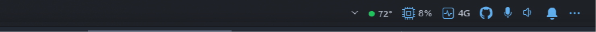

<p align="center">
  
</p>

<h1 align="center">SysWatch</h1>

A quiet machine monitor for Windows: a **status LED for the [YASB](https://github.com/amnweb/yasb) bar** plus **notifications that don't get in your way**. It tells you when you're pushing the machine too hard (RAM, CPU, temperature, disk space, battery) and which program is responsible.

<p align="center">
  
</p>

The icon's LED follows the same colors as the widget:

| OK | Warning | Critical |
|:---:|:---:|:---:|
|  |  |  |

- 🟢 **green**: all good · 🟠 **amber**: something is high · 🔴 **red**: critical · ⚪ gray: monitor not running · hollow ring (○): alerts muted
- The number next to the LED is the CPU temperature (or the CPU load if the temperature isn't readable).
- **Hover** for the details: CPU, RAM, temperature, disk, battery and the programs using the most memory/CPU.

## Alerts that aren't annoying

| | |
|---|---|
| **Sustained, not spikes** | A metric must stay above its threshold for a while (e.g. RAM > 85% for 60 s, CPU > 90% for 3 min). A one-second spike never notifies. |
| **Once per episode** | You get a notification when the level *goes up*, not continuously. Recovery is silent. |
| **Cool-down** | The same metric can't notify again for 30 min (10 min if critical). At most one notification every 2 min overall. |
| **Silent** | Toasts never play a sound, and Windows' Do Not Disturb / Focus rules apply as usual. |
| **Mute with a click** | Left-click the LED to mute notifications for 1 hour (the LED keeps working); click again to unmute. |
| **Tells you who** | "Memory is running low (91%) – Using the most: msedge 3.1 GB, claude 2.0 GB, …" |

## YASB widget

Add this to the `widgets:` section of `~/.config/yasb/config.yaml` (also in [`yasb/sysmon.yaml`](yasb/sysmon.yaml)), put `sysmon` in a bar's `widgets:` list and run `yasbc reload`:

```yaml
  sysmon:
    type: yasb.custom.CustomWidget
    options:
      label: "{data[html]}"
      label_alt: "{data[html_alt]}"
      class_name: sysmon
      tooltip: true
      tooltip_label: "{data[tip]}"
      exec_options:
        run_cmd: 'C:\path\to\SysWatch.exe --widget'
        run_interval: 5000
        return_format: json
        use_shell: false
        encoding: utf-8
      callbacks:
        on_left: 'exec C:\path\to\SysWatch.exe --toggle-snooze'
        on_middle: 'exec taskmgr.exe'
        on_right: toggle_label
```

Left click mutes alerts, middle click opens Task Manager, right click switches to a one-line summary. The widget starts the background monitor by itself when needed, so there's nothing else to install or autostart.

**Compatibility:** tested with YASB 2.0.8. SysWatch uses only the documented options of YASB's [Custom widget](https://github.com/amnweb/yasb/wiki/(Widget)-Custom): `exec_options` with `return_format: json`, `{data[...]}` placeholders, a `class_name` for styling and the `exec` callback. It does **not** modify YASB. As the wiki recommends, quote `run_cmd` if the path contains spaces, e.g. `'"C:\Program Files\SysWatch\SysWatch.exe" --widget'`.

Optional styling, so the widget highlights on hover like the built-in ones, in `styles.css`:

```css
.sysmon:hover { background-color: var(--yasb-white-alpha-08); }
```

> YASB has no catalog for third-party widgets: its theme gallery ([yasb-themes](https://github.com/amnweb/yasb-themes)) is for complete themes (`config.yaml` + `styles.css`) and its core repository only accepts widgets written into YASB itself. SysWatch is therefore published here as a standalone project. If you use it in a theme, mention the requirement ("needs SysWatch.exe") in that theme's *Requirements* field.

## Configuration

`%LOCALAPPDATA%\SysWatch\config.json` is created on first run and is picked up without restarting:

```json
{ "ram":     { "warn": 85, "crit": 93, "warnSec": 60,  "critSec": 20  },
  "cpu":     { "warn": 90, "crit": 98, "warnSec": 180, "critSec": 300 },
  "temp":    { "warn": 85, "crit": 95, "warnSec": 60,  "critSec": 15  },
  "disk":    { "warn": 15, "crit": 8 },
  "battery": { "warn": 20, "crit": 10 },
  "cooldownWarnMin": 30, "cooldownCritMin": 10, "minGapSec": 120, "snoozeMin": 60,
  "toasts": 1 }
```

`ram`, `cpu` and `temp` alert when the value is **at or above** the threshold for the given number of seconds. `disk` (% free on the system drive) and `battery` (only while discharging) alert when the value is **at or below** it. Set `"toasts": 0` to keep only the LED.

## Command line

```
SysWatch.exe                  run the monitor (single instance)
SysWatch.exe --status         print the current status
SysWatch.exe --toggle-snooze  mute / unmute alerts
SysWatch.exe --test-alert     show a test notification
SysWatch.exe --stop           stop the monitor
SysWatch.exe --autostart on   (optional) start with Windows, without YASB
```

The interface follows the Windows language (English, Italian).

## Download

Grab `SysWatch.exe` (or the zip, which also contains the YASB snippet) from the [latest release](https://github.com/robertobissanti/sys-watch/releases/latest) and point the widget's `run_cmd` to it. Each release lists the SHA-256 checksums of its files.

The executable isn't code-signed, so Windows SmartScreen may show *"Windows protected your PC"* the first time. Click **More info → Run anyway**, or build it yourself (below).

## Build

Nothing to install: it uses the C# compiler that ships with Windows (.NET Framework 4.x).

```powershell
.\build.ps1             # creates bin\SysWatch.exe
.\build.ps1 -Package    # also creates dist\SysWatch-<version>.zip and SHA256SUMS.txt
```

> If YASB is running, its widget restarts the monitor every few seconds and the exe can be locked. Stop the monitor right before building (`SysWatch.exe --stop`), or temporarily remove the widget.

## How it works

- A background process samples the machine every 5 s using plain Win32/WMI calls (about 15–35 MB of RAM, negligible CPU) and writes `%LOCALAPPDATA%\SysWatch\status.json`.
- The YASB widget just reads that file (`--widget` answers in ~70 ms).
- Notifications are native Windows toasts, sent through Windows PowerShell 5.1 under their own *SysWatch* identity.
- CPU temperature comes from the ACPI thermal zone (`ThermalZoneInformation`). It needs no admin rights, but not every PC exposes it. If it's missing, the LED simply ignores temperature.

## License

[BSD 3-Clause](LICENSE) © 2026 Roberto Bissanti
